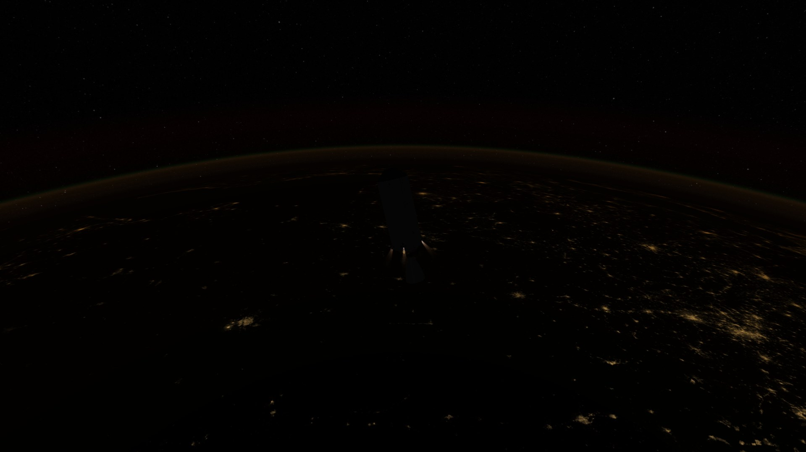

# RealAirglow

https://youtu.be/8SMj5pXQ0a4

**AI-assisted plugin.** RealAirglow was written with an AI coding assistant under my direction.
**RealAirglow** renders Earth's nightglow from real physics.

## Requirements

- KSP 1.12.x on **Windows** (DirectX 11 or OpenGL), **macOS** (Metal or OpenGL) or **Linux** (OpenGL).
- A real-Earth planet pack with a body named `Earth` (**RSS** or **Sol**). *Stock Kerbin is not supported.*
- No other mods are needed. Tested with Sol, Scatterer, EVE volumetric clouds, TUFX and Parallax.

## Use

Open the window with the toolbar button or **Alt+G**.
